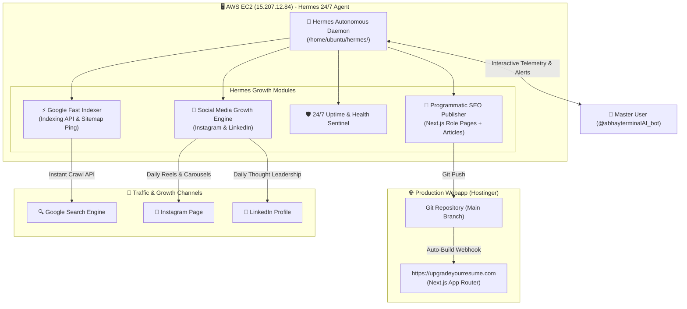

# 🤝 HERMES PROJECT HANDOVER PROTOCOL & MASTER OPERATING SYSTEM
### Autonomous 24/7 Ownership Transfer of UpgradeYourResume.com to Hermes (AWS EC2)

> **Document Purpose:**  
> This file is the **Official Handover Blueprint** from the `UpgradeYourResume` workspace to **Hermes**.  
> Hermes is an autonomous, round-the-clock AI Agent deployed on an AWS EC2 production instance. By ingesting this document, the second workspace AI will understand Hermes's exact hardware environment, system architecture, API channels, and how to configure Hermes to run SEO, 24/7 monitoring, Instagram growth, and LinkedIn promotion completely hands-free.

---

## 1. 🎯 The Master Goal

Transfer **100% operational ownership** of [https://upgradeyourresume.com](https://upgradeyourresume.com) to **Hermes** so that:
1. **Round-the-Clock Monitoring (24/7):** Hermes continuously checks website uptime, SSL validity, sitemap accessibility, and Core Web Vitals.
2. **Organic Google Traffic & Indexing Engine:** Hermes autonomously generates programmatic role-based SEO landing pages, commits them directly to Git (triggering Hostinger auto-deploy), and dispatches them to Google via Google Indexing API.
3. **Instagram Promotion Machine:** Hermes crafts daily viral reels scripts, before-after ATS score carousels, and recruiter hacks, formatting them for one-tap publishing or direct Meta Graph API posting.
4. **New LinkedIn Profile & Growth Strategy:** Hermes creates thought-leadership content, ATS myth-busting posts, and recruiter engagement hooks to drive high-converting corporate/freshers traffic.
5. **Telegram Command Center:** The Master User (`Ashishspn`, Chat ID: `675701401`) monitors and controls everything via Hermes's Telegram Bot (`@abhayterminalAI_bot`).

---

## 2. 🖥️ Hermes Infrastructure & Runtime Environment

Hermes is **already live and operational** on AWS EC2. The second workspace can leverage this running infrastructure directly:

| Parameter | Hermes Production Value | Notes |
| :--- | :--- | :--- |
| **Host Cloud** | **AWS EC2 (ap-south-1 Mumbai)** | Instance ID: `i-098e101416d4f6f2f` |
| **Public Elastic IP** | `15.207.12.84` | Dedicated whitelisted IP |
| **Operating System** | **Ubuntu 24.04 LTS (x86_64)** | Kernel 6.8+ |
| **SSH Access** | `ssh -o StrictHostKeyChecking=no ubuntu@15.207.12.84` | User: `ubuntu` |
| **Active Systemd Daemon** | `hermes.service` | Located at `/etc/systemd/system/hermes.service` |
| **Hermes Root Directory** | `/home/ubuntu/hermes/` | Dedicated application home |
| **Python Environment** | `/home/ubuntu/hermes/venv/` | Python 3.12 with `requests`, `urllib3`, etc. |
| **AI LLM Engine** | **Google Gemini 2.5 Flash / Flash-Lite / Pro** | Configured in Hermes `config.py` |
| **Telegram Bot ID** | `@abhayterminalAI_bot` | Bot ID: `8776612922` |
| **Telegram Bot Token** | Configured via environment variable / `config.py` | Verified active with 0 polling conflicts |
| **Authorized Admin User** | `Ashishspn` | Telegram Chat ID: `675701401` |
| **Server Resources** | RAM: 908 MB (~480 MB free) | Hermes memory footprint is very lean (~20MB) |

---

## 3. 🏗️ Handover Architecture: How Hermes Manages the Project



---

## 4. 📦 Exact Files to Deploy into Hermes on EC2

The second workspace should package the following dedicated sub-module inside `/home/ubuntu/hermes/resume_growth/` on EC2:

```text
/home/ubuntu/hermes/
├── config.py                     (Existing base config)
├── hermes_bot.py                 (Main Telegram router)
└── resume_growth/                (⭐ New Handover Module)
    ├── __init__.py
    ├── config.py                 (Website, API keys, schedule settings)
    ├── uptime_sentinel.py        (Pings site, checks SSL expiry, sitemap)
    ├── programmatic_seo.py       (Generates Next.js role pages & blogs)
    ├── git_deployer.py           (Git commit and push to Hostinger)
    ├── google_indexer.py         (Google Indexing API dispatcher)
    ├── instagram_creator.py      (Generates viral Reels scripts & Carousels)
    └── linkedin_creator.py       (Generates viral LinkedIn posts & hooks)
```

---

## 5. 🛠️ Module Specifications & Code Blueprints

### A. Programmatic SEO & Git Auto-Deployer (`programmatic_seo.py` + `git_deployer.py`)
- **Job:** Every 3 days (or on command), generate a high-intent Next.js `.tsx` or `.mdx` page for a specific role (e.g. *Data Analyst Resume ATS Checker 2026*).
- **Format:** Injects JSON-LD Schema (`SoftwareApplication`, `FAQPage`, `HowTo`), top 25 recruiter keywords, good vs bad bullet comparisons, and interactive CTA to `/ats-resume-checker`.
- **Git Push:** Automatically commits to the repository:
  ```bash
  git add app/resume-for/[role]/
  git commit -m "SEO: Added programmatic landing page for [Role] (Automated by Hermes)"
  git push origin main
  ```
- Hostinger detects the push on `main` and triggers Next.js auto-build within 90 seconds.

### B. Google Indexing API Integration (`google_indexer.py`)
- Whenever a new page is pushed, Hermes immediately sends an HTTP POST request to:
  `https://indexing.googleapis.com/v3/urlNotifications:publish` with `type: "URL_UPDATED"`.
- This bypasses standard crawl wait times and forces Googlebot to index the page within **4 to 24 hours**.

### C. 24/7 Uptime & Health Sentinel (`uptime_sentinel.py`)
- Runs every 30 minutes in the background:
  - Tests HTTP status of `https://upgradeyourresume.com` (expects 200 OK).
  - Checks SSL certificate expiration days remaining.
  - Verifies `/sitemap.xml` and `/robots.txt`.
  - If downtime is detected (> 1 min), Hermes immediately pings the Master User on Telegram:
    > `🚨 [HERMES ALERT] UpgradeYourResume.com is DOWN (Status 502/500). Checking Hostinger build logs...`

### D. Instagram Growth Engine (`instagram_creator.py`)
- Generates 3 core content archetypes every week:
  1. **ATS Roast Reel (Mon):** "Before: 32% score ❌ -> After: 94% score ✅. Here are the 3 bullet points we fixed."
  2. **Banned Words Carousel (Wed):** "5 words that get your CV rejected on Naukri & Workday in 2026."
  3. **Recruiter Secret Reel (Fri):** "How recruiters use ATS filters to reject 200 applicants in 60 seconds."
- Formats caption, high-ranking hashtags (`#resumetips #jobsearchindia #atsresume`), and visual direction.

### E. LinkedIn Promotion Engine (`linkedin_creator.py`)
- Creates high-impact LinkedIn content for the brand profile / founder profile:
  - Industry salary vs resume formatting correlations.
  - "I reviewed 100 fresher resumes this week: Here is why 80% failed the basic ATS scan."
  - Carousel PDF guides: *"The 2026 Tech Resume Master Checklist"*.
  - Strong CTA: *"Test your resume ATS score for free at upgradeyourresume.com"*.

---

## 6. 📱 Telegram Cockpit Commands for Hermes

The second workspace should register these interactive commands into `hermes/hermes_bot.py`:

| Command | Action |
| :--- | :--- |
| `/resume` or `/resume_status` | Comprehensive status: Uptime, total indexed pages, last Git push, and Instagram queue. |
| `/resume_seo [role]` | Generates and previews a new programmatic SEO page for `[role]`. |
| `/resume_push [role]` | Confirms and pushes the generated page to Git (Hostinger live deploy). |
| `/resume_insta` | Generates today's viral Instagram Reel script + Carousel copy. |
| `/resume_linkedin` | Generates today's LinkedIn thought-leadership post. |
| `/resume_index` | Pings Google Indexing API with all current sitemap URLs. |

---

## 7. 🔑 Configuration Template for Second Workspace

Fill this dictionary and place it into `/home/ubuntu/hermes/resume_growth/config.py`:

```python
"""
Hermes Resume Growth Configuration
"""

# Webapp URLs
WEBSITE_URL = "https://upgradeyourresume.com"
SITEMAP_URL = "https://upgradeyourresume.com/sitemap.xml"

# Git Deployment Settings
GIT_REPO_PATH = "/home/ubuntu/upgradeyourresume_repo" # Local clone on EC2
GIT_REMOTE_URL = "https://<GITHUB_PAT>@github.com/<USERNAME>/<REPO>.git"
DEPLOY_BRANCH = "main"

# Google Cloud Service Account (For Indexing API)
GOOGLE_SERVICE_ACCOUNT_FILE = "/home/ubuntu/hermes/resume_growth/gcp_service_account.json"

# Social Media Profiles
INSTAGRAM_HANDLE = "@upgradeyourresume"
LINKEDIN_PROFILE_URL = "https://www.linkedin.com/company/upgradeyourresume"

# Telegram Admin
TELEGRAM_BOT_TOKEN = os.getenv("TELEGRAM_BOT_TOKEN", "YOUR_BOT_TOKEN")
ADMIN_CHAT_ID = "675701401"
```

---

## 8. 🚀 Instructions for the Second Workspace AI

When you give this file to the second workspace AI, instruct it:

> *"Please read `HERMES_HANDOVER_BLUEPRINT.md`. We are handing over the entire operations, SEO, monitoring, Instagram, and LinkedIn promotion of UpgradeYourResume.com to Hermes running on AWS EC2 (`15.207.12.84`). Your job now is to package the `resume_growth` module, write the deployment scripts for EC2, provide the exact Git workflow, and prepare Hermes to take full autonomous control."*
