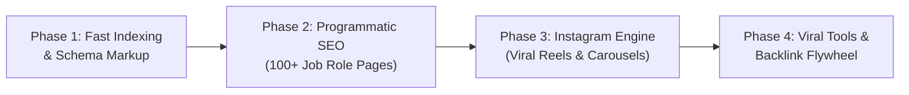

# 🚀 UPGRADE YOUR RESUME — MASTER CONTEXT & AUTONOMOUS GROWTH HANDOFF
> **Project Context Document for New Workspace / New Session**  
> *Target Domain:* [https://upgradeyourresume.com](https://upgradeyourresume.com)  
> *Managed by:* Hermes Autonomous AI Growth Agent  
> *Generated on:* November 01, 2026  

---

## 1. 📌 Project Overview & Current Architecture

- **Website URL:** `https://upgradeyourresume.com`
- **Launch Date:** Live since May 2026
- **Hosting & Infrastructure:** 
  - **Platform:** Hostinger (Deployments triggered via Git push)
  - **Edge / CDN:** Cloudflare (SSL, Edge caching, DDoS protection)
- **Frontend / Tech Stack:** 
  - **Framework:** Next.js (App Router, Turbopack, Geist typography)
  - **Styling:** Tailwind CSS
  - **Payment Gateway:** Razorpay integrated for Pro tier subscriptions
- **Core Active Tools & Features:**
  - `https://upgradeyourresume.com/ats-resume-checker` (Resume upload, ATS score 0-100%, keyword gap analysis)
  - `https://upgradeyourresume.com/ai-resume-writer` (AI-assisted bullet rewrite & summary generation)
  - `https://upgradeyourresume.com/cover-letter-generator` (Tailored cover letters)
  - `https://upgradeyourresume.com/linkedin-optimizer` (Profile headline & about section improver)
  - `https://upgradeyourresume.com/templates` (ATS-compliant templates)
  - `https://upgradeyourresume.com/blog` (8 original articles published in May 2026)

---

## 2. 🔍 Diagnostic Audit: Why Traffic is Currently Zero

A live technical inspection performed on November 01, 2026 revealed:
1. **Content Stagnancy:** The sitemap (`/sitemap.xml`) has had zero updates since May 23, 2026. Google favors fresh, active domains.
2. **Missing Programmatic Long-Tail Pages:** High-volume keywords like *"resume builder"* are dominated by legacy players (Novoresume, Zety). The site currently lacks high-intent role-specific landing pages (e.g., *Data Analyst ATS Resume*, *Fresher B.Tech Resume Format*).
3. **Domain Authority Gap (DA ~1):** Zero incoming backlinks, zero community citations, and no viral referral loops.
4. **Google Search Console & Fast Indexing Inactive:** New URLs take weeks to be discovered organically because Google Indexing API / daily sitemap pings are not configured.
5. **Untapped Social Funnel:** A dedicated Instagram page exists, but lacks an automated pipeline to funnel job seekers into free ATS scans.

---

## 3. 🎯 Approved 4-Phase Growth Roadmap



### Phase 1: Technical SEO & Fast Google Indexing (Days 1 – 3)
- Connect Google Indexing API via Service Account for **24-hour indexation** of new pages.
- Add Rich Snippets: `SoftwareApplication` on ATS Checker, `FAQPage` schema on landing pages, `HowTo` schema on blogs.

### Phase 2: Programmatic SEO Matrix (Weeks 1 – 4)
- Deploy 100+ role-tailored pages under `/resume-for/[job-role]`:
  - `/resume-for/software-engineer-fresher`
  - `/resume-for/data-analyst`
  - `/resume-for/product-manager`
  - `/resume-for/devops-cloud-engineer`
  - `/resume-for/digital-marketing-specialist`
- Each page features targeted ATS keywords, bullet formulas, and a 1-click free resume scan widget.

### Phase 3: Dedicated Instagram Growth Pipeline (Weekly Cadence)
- **Reel Script 1:** *Recruiter Secret* ("Why 75% of CVs fail before a human sees them").
- **Carousel 1:** *Before vs After ATS Score* (Showcasing score jump from 38% to 92%).
- **Reel Script 2:** *5 Words to Delete from Your Resume Immediately*.
- **Funnel:** Hook ➔ High-Value Tip ➔ CTA: *"Check your ATS score for free — link in bio"* ➔ Webapp Signup.

### Phase 4: Viral Referral Loops & Authority Backlinks (Month 2+)
- Free downloadable ATS template repository on GitHub (`awesome-ats-resume-templates`).
- Community engagement on Reddit (`r/developersIndia`, `r/resumes`) and ProductHunt / Peerlist launches.

---

## 4. 🤖 Hermes Autonomous Agent Roles & Responsibilities

In this workspace, **Hermes** acts as the **Autonomous Webmaster & Growth Architect**:
1. **SEO Content Generator:** Writes 1,500+ word technical articles and Next.js role-based components.
2. **Git Publisher:** Creates clean feature commits and pushes directly to Hostinger's deploy branch.
3. **Indexing Dispatcher:** Pings Google Indexing API and Google Search Console automatically.
4. **Social Copywriter:** Generates daily Instagram carousel slides, reels scripts, and hashtags.

---

## 5. 📋 Required Credentials & Inputs (To Fill in the New Workspace)

Copy and fill this section when starting the new session:

```yaml
# 1. Git Repository
git_repo_url: "https://github.com/nextcareerlabpro/next-career-lab"
git_branch: "main"
git_access_token: "CONFIGURED_LOCAL_GIT"
local_project_directory: "D:\\Upgradeyourresume"

# 2. Google Search Console & Indexing API
gsc_verified: true
google_service_account_json: "scripts/service-account.json"
google_analytics_id: "G-XXXXXXXXXX"

# 3. Instagram Channel
instagram_handle: "@upgradeyourresume"
target_audience: "Freshers + Mid-Level Tech/Corporate Professionals in India & Global"
brand_colors: "Primary Blue, Slate, White"

# 4. Product & Pricing
free_scans_per_user: 1
pricing_tiers: "Pro Monthly: ₹299 / Quarterly: ₹699 / Annual: ₹1499"
```

---

## 6. 🚀 Kick-off Prompt for New Workspace

Paste the following message in the new chat to start immediate execution:

> *"Maine is workspace me `UPGRADE_YOUR_RESUME_MASTER_CONTEXT.md` upload kar di hai jisme hamara audited status, architecture aur 4-phase growth plan recorded hai. Credentials section me details fill kar di hain. Ab Phase 1 (Technical SEO, Google Indexing API & Programmatic Pages) se implementation shuru karo."*
